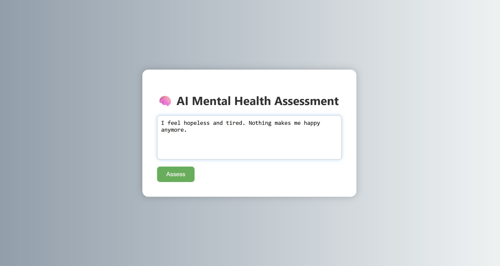

# AI-Based Mental Health Assessment System

## Overview
This project is a web-based AI application that predicts mental health conditions from user input text using Machine Learning and NLP techniques.

## Features
- Predicts mental health condition from text input
- Machine learning model integration
- Simple and interactive web interface

## Tech Stack
- Python
- Flask
- Scikit-learn
- HTML/CSS

## Model
The model is trained using NLP techniques and machine learning algorithms to classify mental health conditions based on user input text.

## How to Run
1. Install dependencies:
   pip install -r requirements.txt

2. Run the application:
   python app.py

3. Open in browser (local):
   http://127.0.0.1:5000/

### Input

### Output

## Future Improvements
- Add chatbot support
- Improve prediction accuracy
- Deploy the application online
