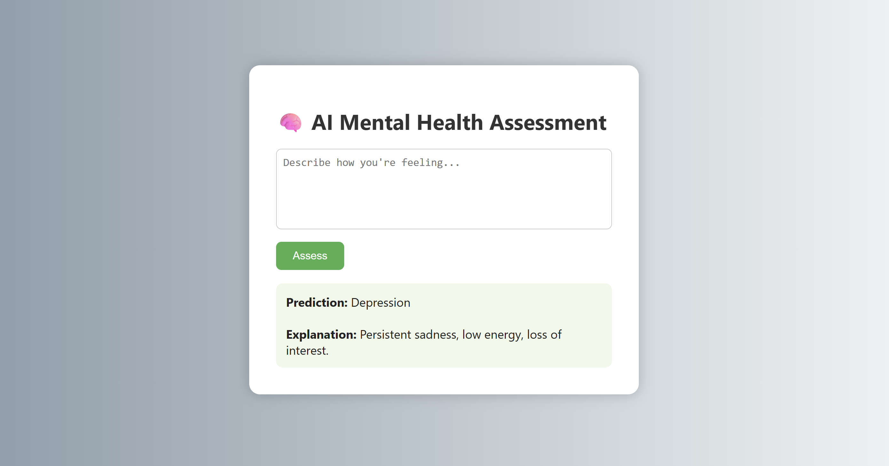

# AI-Based Mental Health Assessment System

**📄 Published Research Paper:** [Read the Research Paper](https://www.researchgate.net/scientific-contributions/Edubilli-Sai-Chakri-2368091681)

## 📌 Overview
The AI-Based Mental Health Assessment System is a web application that analyzes user-provided text using **Natural Language Processing (NLP)** and **Machine Learning** to classify mental health-related text into predefined categories.

## ✨ Features
- Text-based mental health category prediction
- NLP-based text processing and feature extraction
- Machine learning model integration
- Simple and interactive web interface
- Real-time prediction through user input

## 🖥️ Application Screenshots

### Input Interface


### Prediction Output


## 🛠️ Tech Stack
- **Programming Language:** Python
- **Backend:** Flask
- **Machine Learning:** Scikit-learn
- **NLP:** TF-IDF vectorization and text preprocessing
- **Frontend:** HTML and CSS

## 🤖 Model
The system uses Natural Language Processing techniques to transform user-provided text into numerical features. A trained machine learning model uses these features to predict a category based on patterns learned from the training dataset.

## ⚙️ How to Run Locally

### 1. Clone the Repository
```bash
git clone https://github.com/saichakri1122/Mental-Health-AI.git
cd Mental-Health-AI
```

### 2. Install Dependencies
```bash
pip install -r requirements.txt
```

### 3. Start the Application
```bash
python app.py
```

### 4. Open in Your Browser
Visit: http://127.0.0.1:5000/

## 🚀 Future Improvements
- Enhance model performance through improved training and evaluation.
- Develop a conversational interface for more interactive use.
- Improve the user interface and accessibility.
- Deploy the application for public access.

## ⚠️ Disclaimer
This project is intended for educational and research purposes only. Its predictions are not medical diagnoses and should not replace professional mental health assessment.

